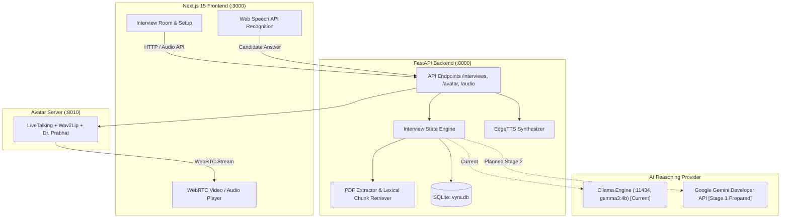

# VYRA — Your AI. Your Interview. Your Growth.

VYRA is an AI-powered voice-based technical interview and academic viva examination platform. It features an interactive, realistic human examiner avatar (**Dr. Prabhat Sharma**), real-time speech interaction, PDF study material grounding with page-level citations, and comprehensive rubric evaluation reports.

---

## Key Features

- **Realistic Examiner Avatar:** Virtual viva chair Dr. Prabhat Sharma powered by LiveTalking and Wav2Lip with synchronized lip movement streamed via WebRTC.
- **Natural Voice Interaction:** Professional Indian English speech synthesis using EdgeTTS (`en-IN-PrabhatNeural`) with integrated browser speech recognition.
- **Syllabus & PDF Grounding:** Upload academic syllabi, lecture notes, or research papers (PDF) to ground interview questions strictly within the provided document, complete with page citations (`Page X`).
- **Dynamic viva Examination:** Formulates foundational opening questions, evaluates candidate answers in real time, and poses adaptive conceptual follow-ups.
- **5-Dimensional Comprehensive Evaluation:** Grades candidate performance across Subject Knowledge, Technical Vocabulary, Communication, Practical/Code Application, and Syllabus Grounding.
- **Graceful Fallbacks:** Built-in resilience with automatic fallback to high-resolution portrait imagery and direct HTML5 audio playback if the WebRTC avatar server is unavailable.

---

## Architecture Overview



### Technology Stack

- **Frontend:** Next.js 15 (App Router), React 19, TypeScript, Lucide React, CSS Modules.
- **Backend:** FastAPI, Python 3.11, SQLAlchemy, SQLite, Pydantic, PyMuPDF (`fitz`), EdgeTTS.
- **AI Reasoning:** 
  - Current: Local Ollama (`gemma3:4b` on CPU).
  - Target: Google Gemini Developer API (`gemini-2.5-flash`) — *Stage 1 prepared, see `HANDOFF.md`*.
- **Avatar & Speech:** LiveTalking, Wav2Lip, WebRTC (`aiortc`), Microsoft EdgeTTS (`en-IN-PrabhatNeural`).

---

## Getting Started

### Prerequisites

- **Node.js:** v18.0.0+ (v20+ recommended)
- **Python:** 3.11
- **Ollama:** Installed locally with model `gemma3:4b` pulled (`ollama pull gemma3:4b`), OR a Google Gemini API key for future Stage 2 implementation.
- *(Optional for live avatar video)*: NVIDIA GPU with CUDA for LiveTalking Wav2Lip microservice.

---

### 1. Backend Setup

```bash
# Navigate to the backend directory
cd backend

# Create and activate a Python 3.11 virtual environment
python -m venv .venv
# Windows:
.venv\Scripts\activate
# Linux/macOS:
source .venv/bin/activate

# Install Python dependencies
pip install -r requirements.txt

# Configure environment variables
copy .env.example .env
# Edit .env and configure any required variables
```

**Start the FastAPI backend:**
```bash
python -m uvicorn app.main:app --host 127.0.0.1 --port 8000 --reload
```
The backend API documentation is available at `http://127.0.0.1:8000/docs`.

---

### 2. Frontend Setup

```bash
# From the project root:
npm install

# Start the Next.js development server
npm run dev
```
Open `http://localhost:3000` in your browser.

---

### 3. Local Development URLs

| Service / View | URL | Purpose |
|---|---|---|
| **Frontend Home** | `http://localhost:3000` | Landing page |
| **Interview Setup & Room** | `http://localhost:3000/interview` | Viva configuration, webcam preview & live examination |
| **Dashboard** | `http://localhost:3000/dashboard` | Candidate statistics & overview |
| **Interview History** | `http://localhost:3000/history` | Historical viva sessions |
| **Performance Reports** | `http://localhost:3000/reports` | Detailed scorecards and examiner feedback |
| **Backend Swagger API** | `http://127.0.0.1:8000/docs` | Interactive OpenAPI documentation |
| **LiveTalking Avatar Server** | `http://127.0.0.1:8010` | Microservice for real-time video avatar *(runs separately)* |

---

## Environment Variables

Copy `backend/.env.example` to `backend/.env`:

```env
# Google Gemini API (For Stage 2 migration)
GEMINI_API_KEY=your_gemini_api_key_here
GEMINI_MODEL=gemini-2.5-flash

# Local Ollama AI Provider (Current default)
OLLAMA_BASE_URL=http://127.0.0.1:11434
OLLAMA_MODEL=gemma3:4b
OLLAMA_TIMEOUT_SECONDS=150.0
OLLAMA_NUM_GPU=0

# LiveTalking Avatar Service
LIVETALKING_BASE_URL=http://127.0.0.1:8010

# Database
DATABASE_URL=sqlite:///./vyra.db
```

> [!WARNING]
> Never commit `.env` or actual API keys to version control. The repository's `.gitignore` is configured to exclude all `.env` files.

---

## Current Project Status & Developer Handover

- **Current AI Provider:** Ollama running `gemma3:4b` locally.
- **Stage 1 Migration Audit:** Complete. Environment configuration, `.gitignore` rules, and Gemini architecture are prepared.
- **Stage 2 Migration:** Pending. Ready for implementation of `GeminiAIProvider` using Google's Gemini Developer API.
- For complete architecture details, migration checklists, and starting instructions, see **[HANDOFF.md](HANDOFF.md)**.

---

## Running Tests

Run the full backend test suite:
```bash
cd backend
pytest tests
```
*(All 19 test cases covering TTS, avatar proxy, interview engine, PDF processing, and session verification pass successfully).*

---

## License

This project is created for educational and academic evaluation prototyping. All rights reserved.
